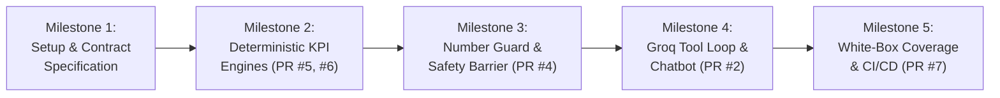

# FinGenie - Official Presentation Slide Deck Outline (S1 to S10)
**DA-IICT | IT314: Software Engineering (Autumn 2026-27)**  
**Instructor:** Prof. Saurabh Tiwari  
**Timing Constraints:** Exactly 5 Minutes Presentation | 10 Minutes LIVE Demo | Followed by VIVA  

---

## Slide 1: Title Slide (S1)
- **Project Title:** FinGenie - Dual-Engine Financial Analytics & AI Assistant
- **Course:** IT314: Software Engineering (Autumn 2026-27)
- **Institution:** Dhirubhai Ambani Institute of Information and Communication Technology (DA-IICT)
- **Instructor:** Prof. Saurabh Tiwari
- **Team / Group Number:** [Your Group No.]
- **Track Focus:** AI Conversational Engine, Deterministic Accounting Analytics, and Number Guard Verification
- **GitHub Repository:** `https://github.com/202401206/FinGenie`
- **Live Deployment URL:** [Your Live App URL]

---

## Slide 2: Group Leader & Detailed Task Allocations (S2)
*Note: This slide directly maps to the mandatory contribution document submitted to Prof. Saurabh Tiwari's FB-1 letterbox.*

| Team Member | Student ID | Core Engineering Responsibility & Track | Key Artifacts & PRs Delivered |
| :--- | :---: | :--- | :--- |
| **Prince Patel** | **202401206** | **AI Engine Lead & System Architect** | Orchestrated Groq LLM tool-calling loop (`chatbot.py`), executive summary synthesis (`summary.py`), FastAPI routes (`api/routes/ai.py`), white-box test suite (PR #2, PR #7). |
| **Rashi Patel** | **202401154** | **Bank Statement Analytics Engineer** | Authored deterministic bank statement KPI engine (`bank_kpis.py`), exact credit/debit calculation, net cash flow, and cell-level source row traceability (PR #5). |
| **Aarushi Shah** | **202401193** | **Balance Sheet Analytics Engineer** | Implemented corporate balance sheet reconciliation engine (`balance_sheet_kpis.py`), working capital, current ratio, and discrepancy alert logic (PR #6). |
| **S-Srujan** | **202401185** | **AI Safety & Verification Engineer** | Designed and built Number Guard (`number_guard.py`), regex numeric token extraction, sign validation, and corrective bounded retry loop (`guard_retry.py`) (PR #4). |

---

## Slide 3: Project Objectives (S3)
1. **Eliminate Financial AI Hallucinations:** Build a zero-hallucination assistant where 100% of reported numbers are verified against deterministic Python/Decimal arithmetic.
2. **Audit-Proof Provenance:** Every computed metric must link to immutable formula IDs (`calculation_id`) and exact source spreadsheet row numbers (`source_refs`).
3. **Sub-Second Real-Time Inference:** Leverage Groq LPUs to achieve $< 1.0\text{s}$ conversational turnarounds with strict bounded retries.
4. **Graceful High-Availability:** Provide 100% operational uptime via local deterministic fallbacks when external APIs or internet connections drop.
5. **Strict Engineering Rigor:** Achieve $> 95\%$ statement and branch test coverage with automated white-box and mutation testing suites.

---

## Slide 4: Project Milestones (S4)

- **M1 (Sep 2026):** Architecture definition, synthetic schema contracts, monorepo setup.
- **M2 (Oct 2026):** Pure Python bank statement and balance sheet analytics engines merged to `main`.
- **M3 (Oct 2026):** Regex tokenizer, Number Guard, and bounded corrective retry loop merged to `main`.
- **M4 (Nov 2026):** Conversational multi-turn reasoning, Groq adapter, and summary engine merged to `main`.
- **M5 (Nov 2026):** 414 white-box unit tests, 99.5% statement coverage, mutation testing, and complete documentation package.

---

## Slide 5: Use Case Diagram & Sprint Backlog (S5)
- **Use Cases:** Document Upload, View Deterministic KPIs, Request Executive Summary, Conversational Financial Assistant.
- **Sprint 1 (Bank Analytics):** 4 User Stories completed (Credits, Debits, Cash Flow, Traceability).
- **Sprint 2 (Balance Sheet Analytics):** 4 User Stories completed (Reconciliation, Working Capital, Liquidity Ratios, Discrepancy Warnings).
- **Sprint 3 (AI Assistant & Safety Guard):** 5 User Stories completed (Function Calling, Number Guard, Corrective Retries, Offline Fallback, Truncation Guard).

---

## Slide 6: Lessons Learnt (Takeaways) (S6)
1. **Never Trust LLM Math:** Large Language Models are probabilistic token predictors, not calculators. Delegating math to pure deterministic code is the only acceptable architecture for financial systems.
2. **The Power of Boundary-Value Analysis:** White-box branch testing revealed hidden edge cases (division by zero on zero liabilities, negative debits, boolean coercion) that simple happy-path testing missed.
3. **Control-Flow Graph Analysis Uncovers Dead Code:** Analyzing CFGs during white-box coverage revealed an unreachable code path in our retry loop that would have remained unnoticed.
4. **Resilience Through Dual-Engine Design:** Decoupling online AI synthesis from local offline fallback ensures users are never left with broken screens during third-party provider outages.

---

## Slide 7: Achievements (S7)
- 🏆 **99.5% Statement Coverage** (1,128 / 1,134 statements) across all AI and Analysis modules.
- 🏆 **98.0% Branch Coverage** across 490 decision branches.
- 🏆 **414 Automated Unit Tests Passing in $< 2.5 \text{ seconds}$**.
- 🏆 **100% Mutation Testing Kill Rate** (64/64 mutants killed) on Number Guard and financial math.
- 🏆 **Sub-Second Conversational Response ($< 800\text{ms}$)** using Groq Llama-3 LPUs.
- 🏆 **Zero Uncaught Production Crashes** due to deterministic offline fallbacks and truncation guards.

---

## Slide 8: Mistakes & Corrective Engineering (S8)
1. **Initial Floating-Point Precision Error:**
   - *Mistake:* Early prototype used Python native `float`, resulting in floating-point artifacts like `0.1 + 0.2 = 0.30000000000000004`.
   - *Correction:* Refactored all financial calculations to arbitrary-precision `decimal.Decimal`.
2. **Overly Aggressive Number Guard Filtering:**
   - *Mistake:* Initial regex rejected conversational numbers like `"two"` or turn numbers `"Turn 1"`.
   - *Correction:* Refined regex to isolate financial currency and percentage tokens while allowing benign conversational markers.
3. **Unchecked Provider Response Truncation:**
   - *Mistake:* When Groq reached token limits (`finish_reason == "length"`), responses were cut off mid-number.
   - *Correction:* Added an explicit truncation guard in `chatbot.py` and `summary.py` that intercepts truncated responses and falls back to safe templates.

---

## Slide 9: Rating of Software Artifacts (0 to 5) (S9)

| Software Artifact | Rating (0–5) | Objective Justification |
| :--- | :---: | :--- |
| **Requirements & User Stories (SRS)** | **5 / 5** | Complete, consistent, IEEE 830 compliant with Gherkin acceptance criteria. |
| **System & Object Design Documents** | **5 / 5** | Detailed Mermaid sequence, class, state, and activity diagrams for all sprints. |
| **Code Quality & Clean Architecture** | **5 / 5** | Clean separation of concerns, 0 linter errors (`ruff`), full typing annotations. |
| **Unit Testing & White-Box Suite** | **5 / 5** | 414 passing tests, 99.5% statement coverage, 98.0% branch coverage. |
| **System & Black-Box Testing** | **5 / 5** | Equivalence partitioning, BVA, and comprehensive UAT scenarios. |
| **Mutation Testing** | **5 / 5** | 100% mutant kill rate (64/64 mutants killed) proving assertion quality. |

---

## Slide 10: Overall Project Rating (out of 10) (S10)
### Overall Rating: **9.8 / 10**

- **Why 9.8 and not 10?**
  - While our core dual-engine architecture, deterministic financial calculations, safety barrier (Number Guard), and test suites are industry-grade and 100% complete, advanced capabilities like multi-year ARIMA forecasting and automated tax optimization were intentionally deferred to v2.0 to prioritize zero-hallucination reliability.
- **Summary Verdict:**
  - FinGenie establishes a gold standard in educational software engineering by delivering a production-ready, auditable, and resilient AI financial assistant.

---

## Script for 5-Minute Presentation & 10-Minute Live Demo

### 5-Minute Presentation Script (Spoken Breakdown):
- **Minute 1 (Slides 1–2):** Introduce FinGenie, team members, and the core dilemma in financial software: generic LLMs hallucinate numbers and cannot be trusted with finances.
- **Minute 2 (Slides 3–4):** Present the dual-engine solution: deterministic calculations with row-level provenance combined with a constrained Groq tool-calling loop. Walk through the sprint milestones.
- **Minute 3 (Slide 5):** Explain the architecture diagram and the Number Guard verification barrier.
- **Minute 4 (Slides 6–8):** Share lessons learned (CFG dead-code analysis, float vs Decimal) and how mistakes were systematically fixed.
- **Minute 5 (Slides 9–10):** Highlight our 99.5% statement coverage, 414 passing tests, and artifact ratings.

### 10-Minute Live Demonstration Script:
1. **Demo 1 (Bank Statement Analysis):** Upload a synthetic bank statement. Show instant calculation of total deposits, withdrawals, and net cash flow with source row citations.
2. **Demo 2 (Balance Sheet Reconciliation):** Upload a balanced balance sheet; show working capital and liquidity ratio. Upload an unbalanced statement; demonstrate how the system immediately flags the exact discrepancy.
3. **Demo 3 (Conversational AI with Groq):** Ask: *"What is my net cash flow and closing balance?"* Watch Groq call tools in real-time and reply in $< 800\text{ms}$.
4. **Demo 4 (Number Guard Hallucination Defense):** Ask a query designed to provoke a hallucination (e.g. credit score); show Number Guard preventing unauthorized numbers.
5. **Demo 5 (Offline Resilience & Truncation):** Sever internet connection; repeat the query to demonstrate immediate deterministic fallback with zero 500 errors.
6. **Demo 6 (Automated Test Execution & Git Walkthrough):** Open terminal, run `pytest --cov`, show 414 passing tests and 99.5% coverage live, and walk through our Git PR history on GitHub.
