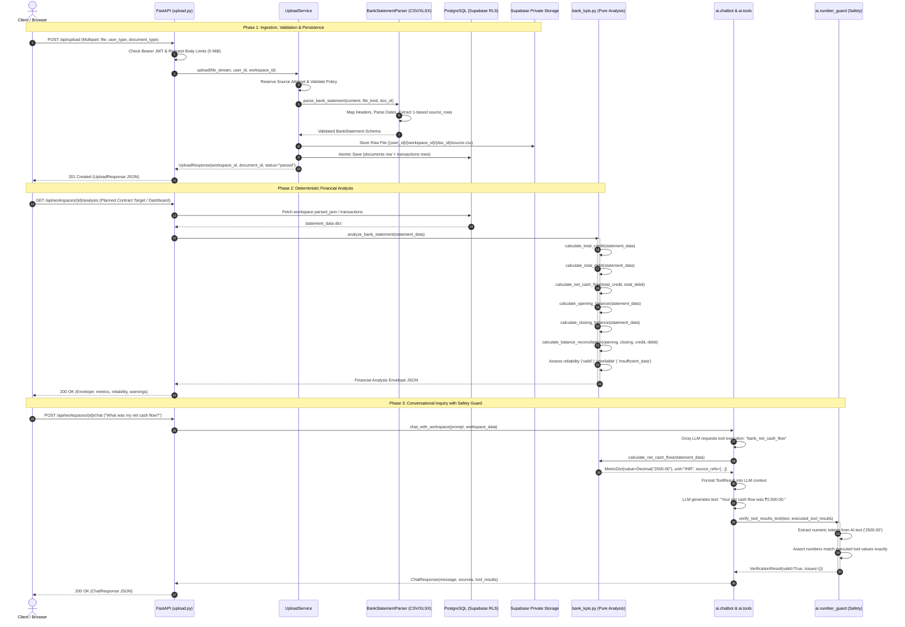
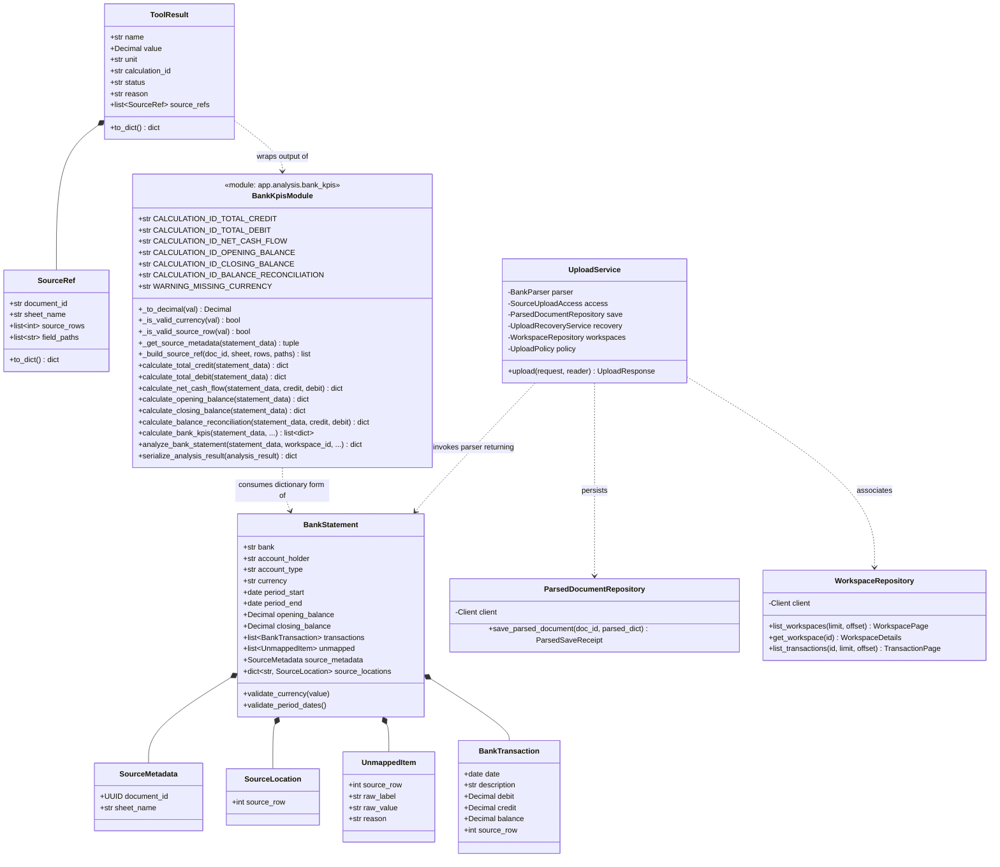

# FinGenie System and Object Design Specification

> **Document Type:** System and Object-Level Architecture Specification
> **Application:** FinGenie Financial Analytics Platform
> **Target Subsystems:** Bank Statement Analytics, Ingestion Pipeline, Schema Validation, and Verification Subsystems
> **Repository Context:** `backend/app/`
> **Primary Authors:** FinGenie Engineering Team (Bank Analytics Track & Architecture)
> **Status:** Active & Implemented (Sprint 1 & Sprint 2 Baseline)

---

## 1. Purpose and Scope

### 1.1 Purpose
The purpose of this document is to specify the architectural, structural, and object/functional design of the FinGenie platform, with a focused deep-dive into the **Bank Statement Analytics** subsystem (`backend/app/analysis/bank_kpis.py`), parser ingestion (`backend/app/parsers/bank_statement/`), schema validation (`backend/app/schemas/bank_statement.py`), and downstream AI verification (`backend/app/ai/tools.py`, `backend/app/ai/number_guard.py`).

FinGenie bridges raw, unstructured financial documents (bank statements in CSV/XLSX formats) and user-facing intelligence. It transforms raw transactions into deterministic, auditable Key Performance Indicators (KPIs) accompanied by natural-language AI insights.

### 1.2 Scope
- **In Scope:**
  - Complete architecture of the FastAPI backend and its interaction with the React/Vite frontend and Supabase (Auth, PostgreSQL with Row-Level Security, private Storage bucket).
  - Component responsibilities, interface boundaries, and data contracts.
  - End-to-end data pipeline from raw file upload to parsed document, deterministic metric calculation, and AI tool routing.
  - Functional and object-level design of [`backend/app/analysis/bank_kpis.py`](../backend/app/analysis/bank_kpis.py), including exact calculation algorithms, source reference mechanics, grouping regexes, and error-handling policies.
  - Pydantic models in [`backend/app/schemas/bank_statement.py`](../backend/app/schemas/bank_statement.py) and data structures in [`backend/app/ai/tools.py`](../backend/app/ai/tools.py).
  - Explicit design principles and patterns genuinely implemented in the codebase.
- **Out of Scope (V1):**
  - Live bank scraping or Open Banking API connections (statements are ingested via exported CSV/XLSX).
  - Scanned PDF OCR parsing (scheduled for future releases).
  - Income statement or multi-file consolidation beyond single-document workspaces.

---

## 2. System Architecture and Component Responsibilities

The FinGenie architecture follows a modular monolith design pattern within a single FastAPI backend application, strictly decoupled from the React/Vite frontend. The architecture strictly isolates deterministic mathematical computation from external I/O, database persistence, and AI text generation.

```
+-----------------------------------------------------------------------------------+
|                              Client Tier (Browser)                                |
|  React 18 + Vite (SPA) • Manrope/Inter Typography • Tailwind/Custom Fintech UI     |
+-----------------------------------------+-----------------------------------------+
                                          | HTTP / REST (Bearer JWT)
                                          v
+-----------------------------------------------------------------------------------+
|                               Backend Tier (FastAPI)                              |
|                                                                                   |
|  [ API Layer: app/api ]                                                           |
|    • router.py             • routes/upload.py          • routes/workspaces.py     |
|    • routes/auth.py        • routes/health.py          • routes/ai.py             |
|                                                                                   |
|  [ Core & Security: app/core ]                                                    |
|    • config.py (Settings)  • security.py (Supabase JWT verification dependency)   |
|                                                                                   |
|  [ Schema & Contracts: app/schemas ]                                              |
|    • bank_statement.py     • common.py                 • workspace_responses.py   |
|    • upload_responses.py   • requests.py               • responses.py             |
|                                                                                   |
|  [ Ingestion & Parsing: app/parsers ]                                             |
|    • bank_statement/csv_parser.py   • bank_statement/xlsx_parser.py               |
|    • errors.py                      • common/                                     |
|                                                                                   |
|  [ Services & Coordination: app/services ]                                        |
|    • upload.py (UploadService)      • upload_validation.py (Policy check)         |
|    • upload_recovery.py             • source_storage.py (Supabase Storage driver) |
|                                                                                   |
|  [ Database Repositories: app/db ]                                                |
|    • repositories/workspaces.py     • repositories/parsed_documents.py            |
|    • dependencies.py                • models.py, errors.py                        |
|                                                                                   |
|  [ Pure Analysis Engine: app/analysis ] (Functional Core — Zero I/O Dependencies) |
|    • bank_kpis.py (Rashi Patel)     • balance_sheet_kpis.py (Aarushi Shah)        |
|                                                                                   |
|  [ AI Intelligence & Safety: app/ai ]                                             |
|    • chatbot.py (Conversational)    • tools.py (Deterministic Tool Router)        |
|    • summary.py (Exec Summary)      • number_guard.py (Deterministic Safety Check)|
|    • providers/groq_provider.py (LLM Adapter)                                     |
+------------------------------------+----------------------------------------------+
                                     | Database Driver (Async HTTP / RLS)
                                     v
+-----------------------------------------------------------------------------------+
|                        Data & Authentication Tier (Supabase)                      |
|  • Supabase Auth (GoTrue JWT)                                                     |
|  • PostgreSQL Database with Row-Level Security (RLS)                              |
|    - Table: workspaces (Owner RLS)                                                |
|    - Table: documents (Workspace FK, unique per workspace in V1)                  |
|    - Table: transactions (Document FK, indexed on date, source_row)               |
|    - Table: upload_cancellations (Recovery state)                                 |
|  • Supabase Storage (Private 'financial-documents' bucket)                        |
+-----------------------------------------------------------------------------------+
```

### 2.1 Component Responsibilities

| Subsystem / Module | Repository Path | Primary Architectural Responsibility | Dependency Constraints |
| :--- | :--- | :--- | :--- |
| **API Layer** | `backend/app/api/` | HTTP request routing, path parameter validation, authentication dependency injection, and HTTP status code translation. | Depends on `core`, `services`, `db`, `schemas`. |
| **Core & Security** | `backend/app/core/` | Configuration loading via Pydantic `BaseSettings`, Supabase bearer-token validation (`require_user`), and security error handling. | Standard library, `pydantic-settings`, `httpx`. |
| **Pydantic Schemas** | `backend/app/schemas/` | Defines shared domain transfer models, field types, constraints (`extra="forbid"`, `gt=0`, non-negative magnitudes), and currency validation. | Standalone models; no database or service imports. |
| **Parsers** | `backend/app/parsers/` | Stream-reads raw CSV or XLSX bytes, detects layouts and column aliases, extracts scalar metadata, and maps records into validated `BankStatement` objects. | Imports `schemas` and standard library (`csv`, `openpyxl`). Zero database or network calls. |
| **Upload Services** | `backend/app/services/` | Coordinates the upload lifecycle: policy validation (file size, max rows), temporary attempt tracking, parser invocation, storage upload, atomic database persistence, and rollback on failure. | Depends on `parsers`, `schemas`, `db/repositories`, and Supabase storage driver. |
| **Database Repositories** | `backend/app/db/repositories/` | Manages relational persistence in Supabase PostgreSQL: workspaces, documents, parsed JSON, and transaction records. Enforces RLS context. | Database client, `schemas`. |
| **Analysis Engine** | `backend/app/analysis/` | Pure Python financial calculation functions. Uses Python `Decimal` for exact arithmetic, tracks 1-based source rows, validates currency presence, and produces complete KPI dictionaries. | **Strictly Pure:** No imports from `api`, `db`, `services`, Supabase, or AI. Zero network/file I/O. |
| **AI Subsystem** | `backend/app/ai/` | Handles executive summarization, conversational multi-turn chat, function-calling tool routing, and numeric post-generation verification. | Calls `analysis` functions as deterministic tools. Bounded retries via `number_guard`. |

---

## 3. Mermaid Architecture Diagram

The diagram below illustrates the actual components and relationships across all tiers:

```mermaid
flowchart TD
    subgraph Client["Client Tier (Browser)"]
        UI["React 18 / Vite SPA"]
        AuthClient["Supabase Auth Client"]
    end

    subgraph API["FastAPI Application (backend/app)"]
        Router["app.api.router: api_router"]

        subgraph Routes["API Routes"]
            R_Health["GET /api/health"]
            R_Auth["GET /api/me"]
            R_Upload["POST /api/upload"]
            R_Workspaces["GET /api/workspaces/*"]
            R_AI["POST /api/workspaces/{id}/chat"]
        end

        subgraph Security["Security & Core"]
            SecDep["core.security: require_user"]
            Settings["core.config: settings"]
        end

        subgraph Ingestion["Ingestion & Parsing"]
            ValPolicy["services.upload_validation: validate_upload"]
            UploadSvc["services.upload: UploadService"]
            ParserEntry["parsers.bank_statement: parse_bank_statement"]
            CSVParser["parsers.bank_statement.csv_parser: parse_bank_statement_csv"]
            XLSXParser["parsers.bank_statement.xlsx_parser: parse_bank_statement_xlsx"]
            StmtSchema["schemas.bank_statement: BankStatement"]
        end

        subgraph Repositories["Data Persistence"]
            WS_Repo["db.repositories.workspaces: WorkspaceRepository"]
            Doc_Repo["db.repositories.parsed_documents: ParsedDocumentRepository"]
            Rec_Svc["services.upload_recovery: UploadRecoveryService"]
        end

        subgraph AnalysisEngine["Pure Analysis Engine (app/analysis)"]
            BankKPIs["bank_kpis.py"]
            Calc_Credit["calculate_total_credit()"]
            Calc_Debit["calculate_total_debit()"]
            Calc_Net["calculate_net_cash_flow()"]
            Calc_Open["calculate_opening_balance()"]
            Calc_Close["calculate_closing_balance()"]
            Calc_Recon["calculate_balance_reconciliation()"]
            Analyze_Stmt["analyze_bank_statement()"]
        end

        subgraph AISubsystem["AI & Safety Guard (app/ai)"]
            Tools["ai.tools: execute_tool"]
            Chatbot["ai.chatbot: chat_with_workspace"]
            Summary["ai.summary: generate_summary"]
            NumGuard["ai.number_guard: verify_tool_results_text"]
            GroqAdapter["ai.providers.groq_provider: GroqProvider"]
        end
    end

    subgraph SupabaseTier["Supabase Cloud / PostgreSQL"]
        S_Auth["Supabase Auth (GoTrue)"]
        S_DB[("PostgreSQL (RLS Enforced)\n• workspaces\n• documents\n• transactions")]
        S_Storage[("Private Storage Bucket\nfinancial-documents")]
    end

    %% Client Interactions
    UI -->|Authenticate| AuthClient
    AuthClient -->|Issue JWT| S_Auth
    UI -->|Bearer JWT + Request| Router
    Router --> R_Health
    Router --> R_Auth
    Router --> R_Upload
    Router --> R_Workspaces
    Router --> R_AI

    %% Security Validation
    R_Auth --> SecDep
    R_Upload --> SecDep
    R_Workspaces --> SecDep
    R_AI --> SecDep
    SecDep -->|Verify Bearer Token| S_Auth

    %% Upload & Parsing Flow
    R_Upload --> ValPolicy
    R_Upload --> UploadSvc
    UploadSvc --> ParserEntry
    ParserEntry --> CSVParser
    ParserEntry --> XLSXParser
    CSVParser --> StmtSchema
    XLSXParser --> StmtSchema
    UploadSvc --> Doc_Repo
    UploadSvc --> Rec_Svc
    Doc_Repo -->|Persist Metadata & Transactions| S_DB
    UploadSvc -->|Persist Source File| S_Storage

    %% Workspace Query Flow
    R_Workspaces --> WS_Repo
    WS_Repo -->|Query with User RLS| S_DB

    %% Analysis Engine Flow
    BankKPIs --- Calc_Credit
    BankKPIs --- Calc_Debit
    BankKPIs --- Calc_Net
    BankKPIs --- Calc_Open
    BankKPIs --- Calc_Close
    BankKPIs --- Calc_Recon
    BankKPIs --- Analyze_Stmt

    %% AI Tool Routing & Verification Flow
    R_AI --> Chatbot
    Chatbot --> Tools
    Tools -->|Deterministic Call| BankKPIs
    Chatbot --> GroqAdapter
    GroqAdapter -->|External LLM Call| Chatbot
    Chatbot --> NumGuard
    NumGuard -->|Verify Numbers Against Tool Evidence| Chatbot
```



---

## 4. Bank Statement Calculation Pipeline

The calculation pipeline ingests raw banking records, normalizes them into structured Pydantic representations, computes mathematical aggregates using pure Python `Decimal` arithmetic, and exposes auditable metrics to API callers and AI agents.

### 4.1 Mermaid Sequence Diagram: Upload to Analytics & AI Verification



> **API Registration Status Note:** `GET /api/workspaces/{id}/analysis` is formally defined in [`contracts/api/README.md`](../contracts/api/README.md) as the planned Sprint 2 contract route for retrieving financial analysis envelopes. In the current live FastAPI application (`backend/app/api/routes/workspaces.py`), workspace detail and transaction listing routes are live, while the dedicated `/analysis` route is scheduled for registration. In the interim, deterministic analysis calculations are fully active and invoked internally by the AI tool router (`backend/app/ai/tools.py`) and verified via automated test runners.

---

## 5. Object, Data Structure, and Module-Level Design

In strict alignment with the repository implementation, the architecture avoids unnecessary object-oriented inheritance frameworks. Instead, it utilizes:
1. **Pydantic Models (`BaseModel`)** for input validation, schema boundaries, and JSON serialization.
2. **Pure Functions and Standard Dictionaries** for the mathematical analysis layer (`bank_kpis.py`).
3. **Standard Library Dataclasses** for intermediate tool routing (`ai/tools.py`).
4. **Service & Repository Classes** for database access, upload lifecycle management, and recovery.

### 5.1 Mermaid Class & Module Structure Diagram



---

## 6. Important Modules, Functions, and Data Structures

### 6.1 `backend/app/analysis/bank_kpis.py`
The primary mathematical computation module for bank statement analytics.

#### Constants & Calculation IDs
```python
CALCULATION_ID_TOTAL_CREDIT = "bank.total_credit.v1"
CALCULATION_ID_TOTAL_DEBIT = "bank.total_debit.v1"
CALCULATION_ID_NET_CASH_FLOW = "bank.net_cash_flow.v1"
CALCULATION_ID_OPENING_BALANCE = "bank.opening_balance.v1"
CALCULATION_ID_CLOSING_BALANCE = "bank.closing_balance.v1"
CALCULATION_ID_BALANCE_RECONCILIATION = "bank.balance_reconciliation.v1"

STATUS_AVAILABLE = "available"
STATUS_UNAVAILABLE = "unavailable"

RELIABILITY_VALID = "valid"
RELIABILITY_UNRELIABLE = "unreliable"
RELIABILITY_INSUFFICIENT_DATA = "insufficient_data"

WARNING_MISSING_CURRENCY = "Missing statement currency; monetary units unconfirmed."
```

#### Key Functions and Algorithms

1. **`_to_decimal(val: Any) -> Decimal`**
   - **Responsibility:** Safely converts arbitrary Python primitives (`int`, `float`, `str`, `Decimal`) to an exact monetary `Decimal`.
   - **Validation Rules:**
     - Rejects `bool` types explicitly (in Python, `isinstance(True, int)` is True).
     - Rejects non-finite values (`Decimal("NaN")`, `Decimal("Infinity")`, `float("nan")`, `float("inf")`, and case-insensitive string `"nan"`/`"inf"`).
     - Supports **International grouping** matching regex `^\d{1,3}(,\d{3})+$` (e.g., `"1,500.00"`).
     - Supports **Indian grouping** matching regex `^\d{1,2}(,\d{2})+(,\d{3})+$` (e.g., `"1,50,000.00"`, `"10,00,000.50"`).
     - Strips commas only after strict pattern matching of the integer part. Malformed commas (e.g., `"1,00"`, `"1,0000"`, `",100"`, `"1,500.0,0"`) raise `InvalidOperation`.
     - Supports optional leading sign (`+`, `-`) for balances.

2. **`calculate_total_credit(statement_data: dict[str, Any]) -> dict[str, Any]`**
   - **Formula:**
     $$\text{Total Credit} = \sum_{i} tx_i.\text{credit} \quad \forall tx_i \text{ where } tx_i.\text{credit} > 0$$
   - **Rules:**
     - Never silently replaces missing transactions or null values with zero.
     - Requires transaction `credit` magnitudes to be non-negative ($\ge 0$).
     - Preserves 1-based `source_row` references and `field_paths: ["transactions[i].credit"]` for all rows where credit $> 0$.
     - If statement currency is missing or blank, returns `status: "unavailable"`, `value: None`, `unit: None`, and `reason: WARNING_MISSING_CURRENCY`, while fully preserving source references.

3. **`calculate_total_debit(statement_data: dict[str, Any]) -> dict[str, Any]`**
   - **Formula:**
     $$\text{Total Debit} = \sum_{i} tx_i.\text{debit} \quad \forall tx_i \text{ where } tx_i.\text{debit} > 0$$
   - **Rules:**
     - Mirrors credit handling with non-negative magnitude enforcement ($\ge 0$).
     - Preserves `field_paths: ["transactions[i].debit"]` and contributing `source_rows`.

4. **`calculate_net_cash_flow(statement_data, total_credit_metric=None, total_debit_metric=None) -> dict[str, Any]`**
   - **Formula:**
     $$\text{Net Cash Flow} = \text{Total Credit} - \text{Total Debit}$$
   - **Rules:**
     - Combines source references from credit and debit transactions into a unique, sorted list of `source_rows`.
     - If either underlying metric is unavailable, net cash flow is marked `unavailable` with an aggregated explanation.

5. **`calculate_opening_balance(statement_data: dict[str, Any]) -> dict[str, Any]`**
   - **Calculation ID:** `"bank.opening_balance.v1"`
   - **Rules:**
     - Extracts `statement_data["opening_balance"]` and parses it via `_to_decimal()`.
     - Inspects `statement_data["source_locations"]["opening_balance"]["source_row"]` and verifies it is a valid positive integer ($\ge 1$).
     - Field path: `["opening_balance"]`.

6. **`calculate_closing_balance(statement_data: dict[str, Any]) -> dict[str, Any]`**
   - **Calculation ID:** `"bank.closing_balance.v1"`
   - **Rules:**
     - Extracts `statement_data["closing_balance"]` and parses it via `_to_decimal()`.
     - Uses `source_locations.closing_balance.source_row` for traceability.

7. **`calculate_balance_reconciliation(statement_data, total_credit_metric=None, total_debit_metric=None) -> dict[str, Any]`**
   - **Verification Formula:**
     $$\text{Expected Closing} = \text{Opening Balance} + \text{Total Credit} - \text{Total Debit}$$
     $$\text{Discrepancy Difference} = \text{Expected Closing} - \text{Closing Balance}$$
   - **Rules:**
     - An exact difference of `Decimal("0")` indicates perfect mathematical balance.
     - A non-zero difference generates an explicit reconciliation mismatch warning while setting `status: "available"` with the difference value.
     - Traceability aggregates `source_rows` across opening balance, transactions, and closing balance.

8. **`analyze_bank_statement(statement_data, workspace_id=None, *, include_reconciliation_metric=False, include_balance_metrics=False) -> dict[str, Any]`**
   - **Responsibility:** Produces the standard top-level Financial Analysis Envelope matching [`contracts/examples/financial-analysis.json`](../contracts/examples/financial-analysis.json).
   - **Reliability Policy:**
     - Always evaluates balance reconciliation internally, even when `include_reconciliation_metric=False`.
     - `reliability = "insufficient_data"` if currency is missing or if any required inputs are unavailable/malformed.
     - `reliability = "unreliable"` if reconciliation difference $\ne 0$.
     - `reliability = "valid"` if all metrics are available and reconciliation difference $= 0$.
   - **Empty Transactions Handling:**
     - Empty transactions (`[]`) with matching opening and closing balances ($O = C$) result in `reliability: "valid"`, zero movement (`credit=0`, `debit=0`, `net=0`), and `warnings: []`.
     - Empty transactions with missing opening or closing balance result in `reliability: "insufficient_data"` with warning.
     - Empty transactions with mismatched balances ($O \ne C$) result in `reliability: "unreliable"`.

9. **`serialize_analysis_result(analysis_result: dict[str, Any]) -> dict[str, Any]`**
   - **Responsibility:** Converts internal Python `Decimal` values into exact JSON numbers (integers for whole amounts like `5000`, floats for fractional amounts like `50.25`) to adhere to JSON number contract standards without losing precision.

---

## 7. Design Principles and Patterns Actually Used

The FinGenie codebase adheres to established software engineering principles. Only patterns with concrete implementations in the code are documented here:

### 7.1 Functional Core, Imperative Shell (FCIS)
- **Implementation:** [`backend/app/analysis/bank_kpis.py`](../backend/app/analysis/bank_kpis.py) is a purely functional core. It has zero network calls, zero database connections, and zero global mutable state. It accepts standard data dictionaries and returns pure data. The imperative shell resides in [`backend/app/services/upload.py`](../backend/app/services/upload.py) and [`backend/app/api/`](../backend/app/api/), which handle database I/O, storage persistence, and HTTP handling.

### 7.2 Router Factory Pattern
- **Implementation:** [`backend/app/api/routes/upload.py`](../backend/app/api/routes/upload.py#L31-L34)
  ```python
  def create_upload_router(
      parser: BankParser, *, policy: UploadPolicy = DEFAULT_POLICY
  ) -> APIRouter:
  ```
  The upload router is instantiated via a factory function that injects the concrete parser implementation (`parse_bank_statement`) and upload policy. This enables seamless substitution of parsers in testing environments without monkey-patching globals.

### 7.3 Protocol / Structural Subtyping
- **Implementation:**
  - `BankParser` protocol in [`backend/app/services/upload.py`](../backend/app/services/upload.py#L42-L46):
    ```python
    class BankParser(Protocol):
        def __call__(self, content: bytes, *, file_kind: str, document_id: UUID) -> BaseModel: ...
    ```
  - `ToolEvidence` protocol in [`backend/app/ai/number_guard.py`](../backend/app/ai/number_guard.py):
    ```python
    class ToolEvidence(Protocol):
        value: object
        unit: str
        status: str
    ```
  This decouples service and guard consumers from concrete class hierarchies.

### 7.4 Fail-Fast & Strict Input Sanitization
- **Implementation:** `_to_decimal()` in [`bank_kpis.py`](../backend/app/analysis/bank_kpis.py#L40-L120).
  Rather than blindly stripping all non-digits, `_to_decimal()` enforces regex structure on the integer part (`INTERNATIONAL_GROUPING_RE` or `INDIAN_GROUPING_RE`) and fractional part (`DECIMAL_PART_RE`). Any malformed groupings immediately raise `InvalidOperation`.

### 7.5 Guarded Execution & Post-Generation Safety Filter
- **Implementation:** [`backend/app/ai/number_guard.py`](../backend/app/ai/number_guard.py) and [`backend/app/ai/chatbot.py`](../backend/app/ai/chatbot.py).
  Before any LLM-generated financial explanation is returned to a client, `verify_tool_results_text()` parses all numeric tokens in the response text and asserts that every stated number is directly backed by an executed `ToolResult`. If an unsupported number is detected, the AI assistant re-prompts the model to self-correct; if correction fails, it raises an HTTP 502 exception rather than emitting inaccurate financial claims.

  **Important Semantic Scope & Limitation:**
  Number Guard provides conservative *numeric-literal verification*, ensuring that every number appearing in the generated text is backed by available tool results. However, **it does not perform semantic validation of metric labels**. Because bare numbers and currency-prefixed literals are checked against the set of executed tool values, Number Guard verifies numeric existence, not prose meaning. Consequently, it does not guarantee that a valid numeric amount has been mapped to the semantically correct KPI label (e.g., if an LLM erroneously writes "Your total credit was ₹2,500.00" when ₹2,500.00 was actually the total debit, Number Guard will confirm that ₹2,500.00 is a verified tool result and permit the response). System designers and prompt engineers must therefore not overstate Number Guard's guarantees: it prevents numeric hallucination, but cannot eliminate semantic misattribution of verified figures in conversational prose.

### 7.6 Standardized Audit Envelope Pattern
- **Implementation:** Shared across [`contracts/examples/financial-analysis.json`](../contracts/examples/financial-analysis.json) and `analyze_bank_statement()`.
  Every metric is encapsulated in a self-describing dictionary containing its value, unit, status, reason, calculation ID, and precise source references.

---

## 8. Error Handling, Validation, and Data Flow

### 8.1 Zero-Tolerance Missing Data Policy
FinGenie enforces a strict financial integrity invariant: **never silently substitute missing data with zero or invented defaults.**
- Missing transaction credit or debit fields cause the metric to become `status: "unavailable"`.
- Missing statement currency marks all monetary metrics `unavailable` with reason `"Missing statement currency; monetary units unconfirmed."`, setting document reliability to `"insufficient_data"`.
- In all error or unavailable states, **source references are preserved** so auditors can trace exactly where the data was absent.

### 8.2 End-to-End Data Flow Matrix

```
[Raw CSV/XLSX File]
       │
       ▼ (Bounded read: max 5 MiB, max 10,000 rows)
[Parser: csv_parser / xlsx_parser]
       │
       ▼ (Validates positive source_row, ISO dates, non-negative credit/debit)
[Pydantic Schema: BankStatement]
       │
       ├───► [Supabase PostgreSQL (documents / transactions tables)]
       │
       ▼ (Converted to Python dictionary)
[Analysis Module: bank_kpis.py]
       │
       ├───► calculate_total_credit()  ───► MetricDict (key="total_credit")
       ├───► calculate_total_debit()   ───► MetricDict (key="total_debit")
       ├───► calculate_net_cash_flow() ───► MetricDict (key="net_cash_flow")
       ├───► calculate_opening_balance() ─► MetricDict (key="opening_balance")
       ├───► calculate_closing_balance() ─► MetricDict (key="closing_balance")
       └───► calculate_balance_reconciliation() ─► MetricDict (key="balance_reconciliation")
       │
       ▼ (Evaluates mathematical integrity)
[Financial Analysis Envelope]
       │  • reliability: "valid" | "unreliable" | "insufficient_data"
       │  • metrics: list of MetricDict
       │  • warnings: list of strings
       │
       ├───► [API Response / Dashboard UI]
       │
       ▼
[AI Tool Execution Engine: tools.py]
       │
       ▼ (Executed ToolResult evidence)
[Groq LLM Generation] ──► [number_guard.py Validation] ──► [Verified Chat Response]
```

---

## 9. References to Relevant Source Files

- [`backend/app/analysis/bank_kpis.py`](../backend/app/analysis/bank_kpis.py): Pure Python bank statement KPI calculations.
- [`backend/tests/analysis/test_bank_kpis.py`](../backend/tests/analysis/test_bank_kpis.py): 119 unit and contract-verification tests.
- [`backend/app/schemas/bank_statement.py`](../backend/app/schemas/bank_statement.py): Pydantic data models for bank statements and transactions.
- [`backend/app/parsers/bank_statement/csv_parser.py`](../backend/app/parsers/bank_statement/csv_parser.py): CSV streaming parser with alias resolution.
- [`backend/app/parsers/bank_statement/xlsx_parser.py`](../backend/app/parsers/bank_statement/xlsx_parser.py): OpenPyXL spreadsheet parser.
- [`backend/app/services/upload.py`](../backend/app/services/upload.py): Upload coordination and persistence service.
- [`backend/app/services/upload_validation.py`](../backend/app/services/upload_validation.py): Upload limits and file validation policies.
- [`backend/app/ai/tools.py`](../backend/app/ai/tools.py): Deterministic tool registry and execution routing.
- [`backend/app/ai/number_guard.py`](../backend/app/ai/number_guard.py): Deterministic numeric verification filter.
- [`contracts/examples/bank-statement.json`](../contracts/examples/bank-statement.json): Synthetic contract fixture for bank statements.
- [`contracts/examples/financial-analysis.json`](../contracts/examples/financial-analysis.json): Synthetic contract fixture for financial analysis.
- [`docs/architecture.md`](architecture.md): High-level system architecture and module boundaries.
- [`docs/database-schema.md`](database-schema.md): Database tables, constraints, and RLS policies.
